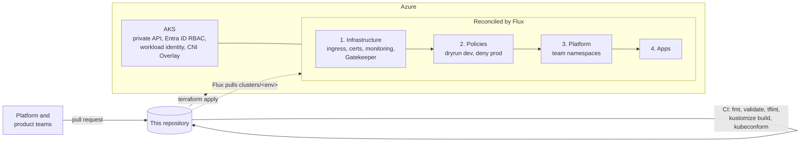

# AKS GitOps Platform

An internal developer platform foundation on Azure Kubernetes Service. Terraform builds a hardened cluster, Flux takes over from there, and product teams get a policy-guarded namespace through a single pull request.




## What you get

| Capability | How |
| --- | --- |
| Hardened cluster | Private API server toggle, Entra ID with Azure RBAC and local accounts disabled, system pool reserved for critical add-ons, zonal autoscaling pools, ephemeral OS disks |
| Secretless identity | OIDC issuer and workload identity, federated managed identities created from a Terraform map, Key Vault CSI driver |
| GitOps from day zero | Flux installed as an AKS extension by Terraform, reconciling four layers with explicit `dependsOn` |
| Shared add-ons | ingress-nginx, cert-manager with Let's Encrypt issuers, kube-prometheus-stack, Gatekeeper, external-dns (prod) |
| Policy as code | Four ConstraintTemplates, five Constraints, `dryrun` in dev and `deny` in prod from one base |
| Namespace as a service | One kustomize component gives every team quota, defaults, default-deny networking, Entra group RBAC and a workload identity service account |
| Sample tenant | podinfo onboarded through the same path as any team, compliant with every policy |
| CI | Terraform fmt, validate and tflint; every overlay rendered and schema-checked; yamllint. Actions pinned to commit SHAs, tools pinned with checksums |

## Repository layout

```text
.
├── infra/terraform/              # Azure: network, AKS, node pools, identities, monitoring, Flux bootstrap
│   └── environments/             # dev / prod tfvars and backend settings (placeholders)
├── clusters/
│   ├── dev/                      # Flux entry point per environment: the layer graph
│   └── prod/
├── infrastructure/
│   ├── controllers/{base,dev,prod}/  # HelmRepository + HelmRelease per add-on, env patches
│   ├── configs/                  # ClusterIssuers, PodMonitors (need CRDs from controllers)
│   └── optional/external-dns/    # opt-in add-on, enabled in prod
├── policies/
│   ├── templates/                # Gatekeeper ConstraintTemplates (Rego)
│   └── constraints/{base,dev,prod}/  # Constraints, enforcement mode per environment
├── platform/
│   ├── components/team-namespace/    # the namespace-as-a-service template
│   └── teams/                    # one folder per team
├── apps/
│   ├── base/podinfo/             # sample tenant workload
│   └── {dev,prod}/
├── scripts/validate-manifests.sh # renders and validates every overlay (used by CI)
├── docs/                         # architecture, GitOps flow, onboarding, upgrades, ADRs
└── .github/workflows/ci.yml
```

## Quick start

Prerequisites: Azure CLI, Terraform 1.9 or later, kubectl with [kubelogin](https://azure.github.io/kubelogin/), an Azure subscription, an Entra ID group for cluster admins, and a storage account for Terraform state. Fork this repository first, since Flux reconciles from the URL in `gitops.repository_url`.

1. Fill in the placeholders in `infra/terraform/environments/dev.tfvars` (subscription, admin group object ID, your fork's URL, an allowed IP range) and `dev.backend.hcl`.

2. Create the cluster. Flux is installed as part of the apply.

   ```bash
   cd infra/terraform
   az login
   terraform init -backend-config=environments/dev.backend.hcl
   terraform plan -var-file=environments/dev.tfvars -out=dev.tfplan
   terraform apply dev.tfplan
   ```

3. Connect and watch the layers converge.

   ```bash
   eval "$(terraform output -raw get_credentials_command)"
   kubectl get kustomizations -n flux-system --watch
   kubectl get helmreleases -A
   ```

4. Onboard a team: [three steps, one pull request](docs/onboarding-a-team.md).

Validate everything locally without a cluster:

```bash
terraform -chdir=infra/terraform fmt -check -recursive
terraform -chdir=infra/terraform init -backend=false && terraform -chdir=infra/terraform validate
tflint --chdir=infra/terraform --config="$PWD/.tflint.hcl" --init
tflint --chdir=infra/terraform --config="$PWD/.tflint.hcl"
scripts/validate-manifests.sh
yamllint --strict .
```

## Design principles

**Golden path.** There is one supported way to get a namespace, ship a workload and expose it over HTTPS, and it is written down as code in this repository. The podinfo sample is not special-cased; it takes the same path a team would.

**Policy as code.** Guardrails are Gatekeeper constraints reviewed in pull requests, not wiki pages. A new policy starts in `dryrun`, shows its violations in the audit, and only then is switched to `deny` in prod.

**Self-service.** Onboarding a team is a folder and a line in a kustomization. The platform team reviews the pull request; it does not run commands on the team's behalf.

**Secure by default.** No local cluster accounts, no client secrets for workloads, default-deny network policies, Pod Security Admission under Gatekeeper, a private API server in prod, and add-ons pinned to exact versions so nothing changes without a review.

**Clear ownership boundaries.** Terraform owns Azure resources and stops at the Flux bootstrap. Flux owns everything inside the cluster. No object is managed by both.

## Documentation

| Document | Covers |
| --- | --- |
| [Architecture](docs/architecture.md) | Azure resources, layer graph, tenant boundary, decisions encoded in Terraform |
| [GitOps flow](docs/gitops-flow.md) | From pull request to running workload, reconciliation intervals, promotion, break-glass |
| [Onboarding a team](docs/onboarding-a-team.md) | The three steps and what a team receives |
| [Upgrade strategy](docs/upgrade-strategy.md) | Kubernetes versions, chart versions, policy rollouts |
| [ADRs](docs/adr/README.md) | Flux extension, tenancy model, Gatekeeper, ingress and Gateway API |

## Status and scope

This is a reference foundation, built to be read and forked. The Terraform validates and lints cleanly, and every overlay renders with kustomize; CI adds schema validation with kubeconform. The placeholders (`example.com`, `contoso`, all-zero GUIDs) must be replaced before an apply. Application CI, team-owned Key Vaults and multi-cluster fleet management are out of scope; see [architecture](docs/architecture.md#what-is-deliberately-out-of-scope).

## License

[MIT](LICENSE) © 2026 Giselle Da Costa
