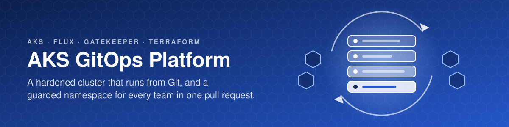
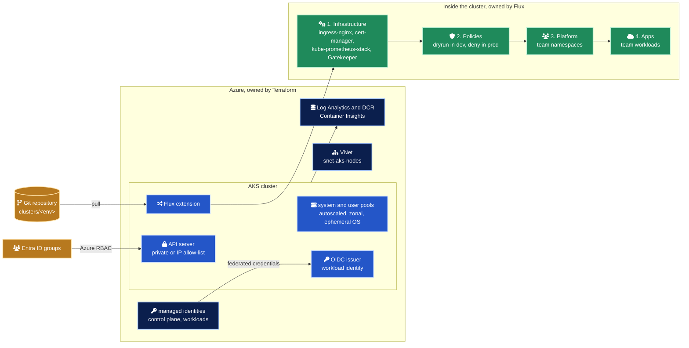
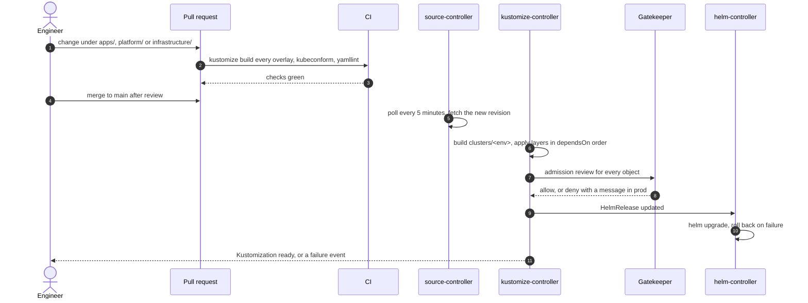
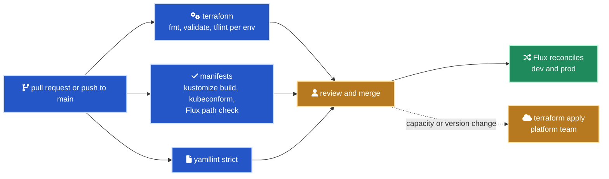

<div align="center">



# AKS GitOps Platform

An internal developer platform foundation on Azure Kubernetes Service.<br>
Terraform builds a hardened cluster, Flux takes over from Git, and every team gets a policy-guarded namespace through one pull request.

[](infra/terraform/aks.tf)
[](infra/terraform)
[](clusters)
[](infrastructure/controllers/base)
[](policies)
[](infrastructure/controllers/base/kube-prometheus-stack.yaml)
[](LICENSE)

</div>

## In numbers

| | |
| ---: | --- |
| 2 | Environments, dev and prod, from one base and two overlays |
| 14 | Terraform resource blocks, from the VNet to the Flux bootstrap |
| 6 | Flux Kustomizations per cluster, reconciled in 4 ordered layers |
| 6 | Helm charts pinned to exact versions, 5 shared add-ons and 1 sample tenant |
| 4 | Gatekeeper ConstraintTemplates, enforced through 5 Constraints |
| 17 | Kustomizations, 16 rendered and checked in CI plus 1 reusable namespace component |
| 5 | NetworkPolicies in every tenant namespace, starting from default deny |
| 0 | Local cluster accounts. Access is Entra ID only |
| 4 | Architecture decision records |

## What it is

Platform teams need one supported way to get a namespace, ship a workload and expose it over HTTPS. This repository writes that golden path down as code.

Terraform owns the Azure side and stops at the Flux bootstrap. Flux owns everything inside the cluster, so the cluster can be rebuilt from two inputs, the Terraform variables and this repository. Product teams onboard with a folder and one line in a pull request, and Gatekeeper keeps every tenant inside the same guardrails. The podinfo sample takes exactly the path a real team would.

## Architecture



| Area | Choice | Why |
| --- | --- | --- |
| API server | Private in prod, IP allow-list in dev | Never open to the whole internet |
| Authentication | Entra ID with Azure RBAC, local accounts disabled | No static admin kubeconfig exists to leak |
| Workload auth | OIDC issuer and workload identity, federated identities from a Terraform map | Pods get Entra tokens without client secrets |
| Networking | Azure CNI Overlay with the Cilium dataplane and network policy | Pods do not consume VNet addresses, Cilium enforces the tenant default deny |
| Node pools | System pool tainted `CriticalAddonsOnly`, autoscaled zonal user pools, Azure Linux, ephemeral OS disks | A noisy tenant cannot starve CoreDNS or the Flux controllers |
| Upgrades | `patch` auto-upgrade, `NodeImage` OS channel, weekly maintenance window | Patches land automatically, minor versions stay a reviewed change |
| Secrets | Key Vault CSI driver with rotation | Secrets are mounted from Key Vault, never committed |
| Policy | Upstream Gatekeeper through Flux, Azure Policy add-on off | One Gatekeeper, reviewed like any other add-on |

More diagrams, including the tenant boundary and the admission order, are in [docs/architecture.md](docs/architecture.md).

## From pull request to running workload



Nobody runs `kubectl apply` or `helm upgrade` against a shared environment. Flux corrects drift on the next reconciliation. Intervals, promotion and break-glass are in [docs/gitops-flow.md](docs/gitops-flow.md).

## Environments

| | dev | prod |
| --- | --- | --- |
| API server | Public, IP allow-list | Private |
| AKS tier | Free | Standard |
| System pool | `Standard_D2ds_v5`, 1 to 3 nodes, zone 1 | `Standard_D4ds_v5`, 3 to 5 nodes, zones 1 to 3 |
| User pool `apps` | `Standard_D4ds_v5`, 1 to 5 nodes, zone 1 | `Standard_D8ds_v5`, 3 to 15 nodes, zones 1 to 3, surge 20% |
| Container Insights | Off | On, 90-day retention |
| Gatekeeper | `dryrun`, 1 replica | `deny`, 3 replicas, webhook fails closed |
| ingress-nginx | 1 replica | 3 replicas |
| Prometheus | 3-day retention, 20 Gi volume | 15-day retention, 2 replicas, 2 Alertmanager replicas |
| external-dns | Off | On, with its own workload identity |
| podinfo sample | 1 replica, staging certificate | 3 replicas, production certificate, spread across zones |

## Quick start

Validate everything locally, without a cluster or an Azure account.

```bash
git clone https://github.com/marlyngiselle/aks-gitops-platform.git
cd aks-gitops-platform
terraform -chdir=infra/terraform fmt -check -recursive
terraform -chdir=infra/terraform init -backend=false
terraform -chdir=infra/terraform validate
scripts/validate-manifests.sh
yamllint --strict .
```

Deploy the dev cluster from your own fork, because Flux reconciles from the repository URL you give it. You need the Azure CLI, the GitHub CLI, Terraform 1.9 or later, kubectl with [kubelogin](https://azure.github.io/kubelogin/), and rights to create an Entra ID group.

```bash
gh repo fork marlyngiselle/aks-gitops-platform --clone
cd aks-gitops-platform/infra/terraform
az login

az group create --name rg-tfstate-weu --location westeurope
STATE_SA="sttfstate$(az account show --query id --output tsv | tr -d '-' | cut -c1-12)"
az storage account create --name "$STATE_SA" --resource-group rg-tfstate-weu --sku Standard_LRS \
  --allow-shared-key-access false --min-tls-version TLS1_2
az storage container-rm create --storage-account "$STATE_SA" --name tfstate
az role assignment create --assignee "$(az ad signed-in-user show --query id --output tsv)" \
  --role "Storage Blob Data Contributor" --scope "$(az storage account show --name "$STATE_SA" --query id --output tsv)"

ADMIN_GROUP="$(az ad group create --display-name aks-gitops-admins --mail-nickname aks-gitops-admins --query id --output tsv)"
az ad group member add --group "$ADMIN_GROUP" --member-id "$(az ad signed-in-user show --query id --output tsv)"

cat > dev.auto.tfvars <<EOF
subscription_id                 = "$(az account show --query id --output tsv)"
admin_group_object_ids          = ["$ADMIN_GROUP"]
api_server_authorized_ip_ranges = ["$(curl -s https://api.ipify.org)/32"]
gitops                          = { repository_url = "https://github.com/$(gh api user --jq .login)/aks-gitops-platform", branch = "main" }
EOF

terraform init -backend-config=environments/dev.backend.hcl -backend-config="storage_account_name=$STATE_SA"
terraform plan -var-file=environments/dev.tfvars -var-file=dev.auto.tfvars -out=dev.tfplan
terraform apply dev.tfplan

eval "$(terraform output -raw get_credentials_command)"
kubectl get kustomizations -n flux-system --watch
```

`dev.auto.tfvars` holds your real values and is ignored by Git. Passed last, it wins over the placeholders in `environments/dev.tfvars`. To onboard a team next, follow [three steps, one pull request](docs/onboarding-a-team.md).

## Access model

| Who | Gets | How |
| --- | --- | --- |
| Platform admins | Cluster admin | Entra ID group in `admin_group_object_ids`, Azure RBAC |
| Team engineers | Built-in `edit` role in their own namespace only | `team-edit` RoleBinding to the team's Entra group, plus the AKS Cluster User role to fetch credentials |
| Team workloads | Entra tokens, no secrets | `workload` ServiceAccount federated with the team's managed identity |
| Platform add-ons | Entra tokens, no secrets | `workload_identities` map in Terraform, external-dns by default |
| Flux | Cluster scope for platform layers | AKS Flux extension, tenant isolation through namespace RBAC and Gatekeeper |
| Anyone with a static kubeconfig | Nothing | Local accounts are disabled |

What every tenant namespace receives from the [team-namespace component](platform/components/team-namespace):

| Object | Effect |
| --- | --- |
| Namespace | `team`, `cost-center` and `tier: tenant` labels, Pod Security `baseline` enforced and `restricted` warned |
| ResourceQuota | CPU and memory from the team config, pod and PVC caps, no LoadBalancer or NodePort services |
| LimitRange | Default requests and memory limit for containers that declare none |
| NetworkPolicies | Default deny in and out, then DNS, same namespace, ingress-nginx and Prometheus scraping |
| RoleBinding | `edit` for the team's Entra group |
| ServiceAccount | `workload`, annotated with the workload identity client ID |

## Delivery



| Step | Mode |
| --- | --- |
| CI checks in [`ci.yml`](.github/workflows/ci.yml) | Automatic, actions pinned to commit SHAs, kustomize and kubeconform verified by checksum |
| Everything inside the cluster | Automatic after merge, through Flux |
| Azure resources | Manual `terraform apply`, reviewed plan |
| Kubernetes patch versions and node images | Automatic, inside the weekly maintenance window |
| Kubernetes minor versions and chart versions | Pull request, dev first ([upgrade strategy](docs/upgrade-strategy.md)) |

## Before you touch anything

> [!IMPORTANT]
> The committed tfvars and backend files hold placeholders (`contoso`, `example.com`, all-zero GUIDs). Flux reconciles from `gitops.repository_url`, so a cluster pointed at someone else's repository runs their changes, not yours.

> [!WARNING]
> In prod the Gatekeeper webhook fails closed. If Gatekeeper is down, admission for the objects it validates is refused until it recovers.

> [!WARNING]
> The prod API server is private. `kubectl` and any CI job that talks to the cluster need private connectivity through VPN, ExpressRoute or a jump host.

> [!CAUTION]
> Do not fix things with `kubectl` on a shared cluster, Flux reverts them. For an incident, suspend the affected Kustomization first and resume it once the fix is in Git ([break-glass](docs/gitops-flow.md#break-glass)).

> [!NOTE]
> The tenants layer runs with `prune: false`. Removing a team folder never deletes its namespace. Offboarding is a pull request plus a deliberate manual delete.

## Repository map

| Path | Role |
| --- | --- |
| [`infra/terraform`](infra/terraform) | Network, AKS, node pools, identities, monitoring, Flux bootstrap |
| [`infra/terraform/environments`](infra/terraform/environments) | dev and prod tfvars and backend settings |
| [`clusters`](clusters) | Flux entry point per environment, the layer graph |
| [`infrastructure/controllers`](infrastructure/controllers) | HelmRepository and HelmRelease per add-on, with dev and prod patches |
| [`infrastructure/configs`](infrastructure/configs) | ClusterIssuers and PodMonitors, which need CRDs from the controllers |
| [`infrastructure/optional/external-dns`](infrastructure/optional/external-dns) | Opt-in add-on, enabled in prod |
| [`policies/templates`](policies/templates) | Gatekeeper ConstraintTemplates in Rego |
| [`policies/constraints`](policies/constraints) | Constraints, with the enforcement mode set per environment |
| [`platform/components/team-namespace`](platform/components/team-namespace) | The namespace as a service template |
| [`platform/teams`](platform/teams) | One folder per team |
| [`apps`](apps) | Sample tenant workload with dev and prod overlays |
| [`scripts/validate-manifests.sh`](scripts/validate-manifests.sh) | Renders and validates every overlay, used by CI |

## Documentation

| Document | Covers |
| --- | --- |
| [Architecture](docs/architecture.md) | Azure resources, layer graph, tenant boundary, decisions encoded in Terraform, scope limits |
| [GitOps flow](docs/gitops-flow.md) | Pull request to running workload, reconciliation intervals, promotion, break-glass |
| [Onboarding a team](docs/onboarding-a-team.md) | The three steps and what a team receives |
| [Upgrade strategy](docs/upgrade-strategy.md) | Kubernetes versions, chart versions, policy rollouts |
| [ADR 0001](docs/adr/0001-flux-via-aks-extension.md) | Bootstrap Flux through the AKS cluster extension |
| [ADR 0002](docs/adr/0002-namespace-as-a-service.md) | Tenancy through a kustomize namespace component |
| [ADR 0003](docs/adr/0003-gatekeeper-via-flux.md) | Upstream Gatekeeper through Flux instead of the Azure Policy add-on |
| [ADR 0004](docs/adr/0004-ingress-now-gateway-api-next.md) | ingress-nginx today, Gateway API as the next step |

Application CI, team-owned Key Vaults and multi-cluster fleet management are out of scope on purpose, see [what is deliberately out of scope](docs/architecture.md#what-is-deliberately-out-of-scope).

<div align="center">
<br>
<sub>MIT licensed · © 2026 Giselle Da Costa</sub>
</div>
