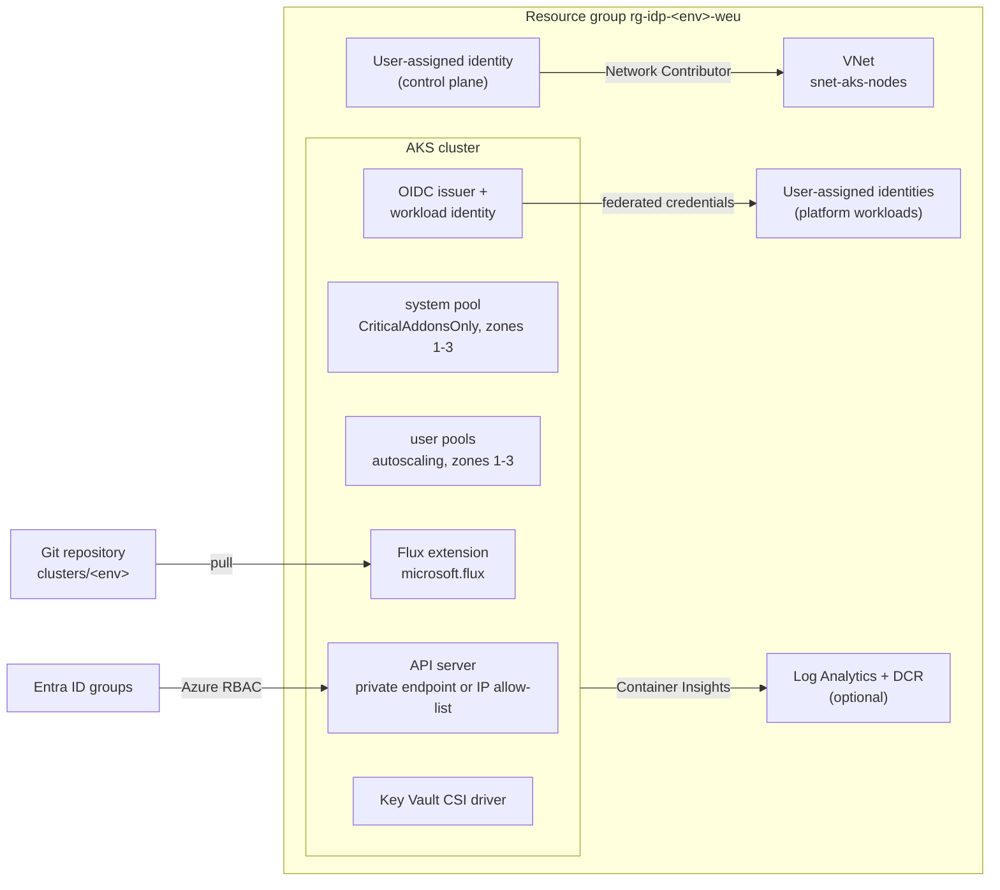
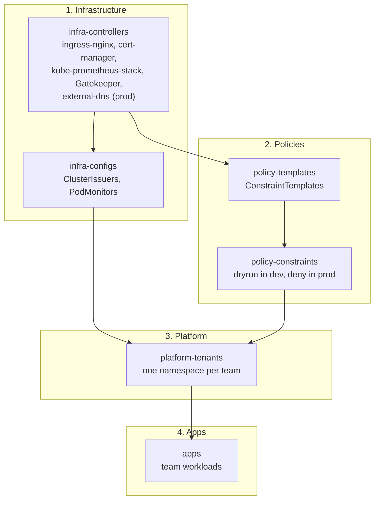
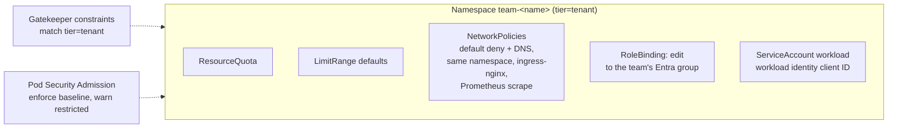

# Architecture

The platform has two halves with a hard boundary between them.

| Half | Owned by | Tool | Changes when |
| --- | --- | --- | --- |
| Azure resources (network, cluster, node pools, identities, monitoring, Flux bootstrap) | Platform team | Terraform, `infra/terraform` | Capacity, versions or cluster features change |
| Everything inside the cluster (add-ons, policies, tenants, apps) | Platform team and product teams | Flux, everything outside `infra/` | Any merge to `main` |

Terraform stops at the point where Flux can take over. It never runs `helm` or `kubectl`, and Flux never touches Azure resources. That keeps state in one place per object and makes the cluster rebuildable from two inputs, the Terraform variables and this repository.

## Azure resources

### Decisions encoded in Terraform

| Area | Choice | Why |
| --- | --- | --- |
| API server | `private_cluster_enabled` toggle; public mode requires an IP allow-list | Prod is private. Dev can stay public but never open to the internet |
| Authentication | Entra ID with Azure RBAC, `local_account_disabled = true` | No static admin kubeconfig exists to leak; access is revoked by removing a group membership |
| Workload auth | OIDC issuer and workload identity enabled; `var.workload_identities` creates federated identities | Pods get Entra tokens without client secrets |
| Networking | Azure CNI Overlay, Cilium dataplane and network policy | Pods do not consume VNet addresses, so the node subnet stays small; Cilium enforces the default-deny policies of the tenant template |
| Node pools | System pool tainted `CriticalAddonsOnly`, user pools for workloads, all autoscaled and zonal, ephemeral OS disks | A noisy tenant cannot starve CoreDNS or the Flux controllers |
| Upgrades | `patch` auto-upgrade channel, `NodeImage` OS channel, weekly maintenance window | Patches and CVE fixes land automatically; minor versions stay a reviewed change (see [upgrade strategy](upgrade-strategy.md)) |
| Monitoring | Container Insights toggle, managed identity auth, data collection rule with ContainerLogV2 | Logs and inventory in Azure Monitor; metrics stay in-cluster with Prometheus |
| Secrets | Key Vault CSI driver add-on with rotation | Secrets are mounted from Key Vault, never committed |
| Policy | Azure Policy add-on disabled | Gatekeeper is installed by Flux instead ([ADR 0003](adr/0003-gatekeeper-via-flux.md)) |

## Inside the cluster

Flux reconciles `clusters/<env>`, which declares six Flux Kustomizations in four layers. Each layer waits for the previous one to become healthy.

| Layer | Path | Contents |
| --- | --- | --- |
| Infrastructure | `infrastructure/controllers/<env>`, `infrastructure/configs` | Helm releases for shared add-ons, then objects that need their CRDs |
| Policies | `policies/templates`, `policies/constraints/<env>` | Gatekeeper templates, then constraints. Two steps because each template registers the CRD its constraint needs |
| Platform | `platform/teams` | Tenant namespaces rendered from `platform/components/team-namespace` |
| Apps | `apps/<env>` | Team workloads, here the podinfo sample |

### Tenant boundary

Every tenant namespace is rendered from the same component and gets the same guardrails.

Admission runs in this order for a tenant pod: the LimitRange injects default resources, Pod Security Admission checks the baseline profile, and Gatekeeper checks registries, privilege and resources. A workload that relies on the defaults still passes the resource constraint.

## What is deliberately out of scope

- Application CI and image builds. Teams push images to the platform registry; this repository only deploys them.
- Secrets content. The Key Vault CSI driver and workload identity are wired up, Key Vaults and their secrets belong to each team's own infrastructure.
- Multi-cluster fleet management. Two environments are enough to show the overlay model; more clusters follow the same `clusters/<name>` pattern.
