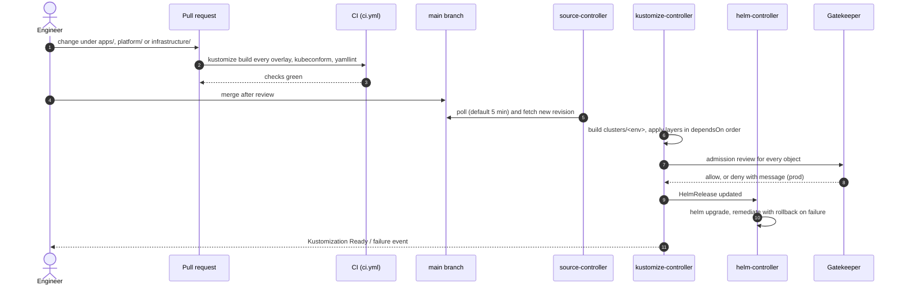

# GitOps flow

Git is the only way to change what runs in the cluster. Nobody runs `kubectl apply` or `helm upgrade` against a shared environment; the Azure RBAC role given to teams makes that a read-mostly cluster for humans, and Flux corrects drift on the next reconciliation.

## From pull request to running workload



## Reconciliation settings

| Object | Interval | Why |
| --- | --- | --- |
| GitRepository (`cluster-config`) | 300 s (Terraform `gitops.sync_interval_in_seconds`) | How quickly a merge reaches the cluster |
| Infrastructure Kustomizations | 1 h, retry 2 min | Slow-moving; the retry interval covers first install, when CRDs arrive late |
| Policy Kustomizations | 1 h, retry 1 min | Constraints are retried until their template CRDs exist |
| Apps Kustomization | 10 min | Re-asserts the desired state of team workloads more often |
| HelmReleases | 10-30 min, drift detection on | Manual edits to Helm-managed objects are reverted |

## Promotion between environments

Both environments read the same branch. Differences live in the overlays (`infrastructure/controllers/<env>`, `policies/constraints/<env>`, `apps/<env>`), so a change is promoted by editing the prod overlay in a separate pull request, after it has run in dev.

| Change | Dev | Prod |
| --- | --- | --- |
| Chart version bump | Edit `base`, observe dev | Already in prod through `base`, so test bumps in the dev overlay first when the risk is high |
| New Gatekeeper constraint | Added to `base`, runs as `dryrun` | Override to `dryrun` in the prod overlay until the audit is clean, then remove the override |
| New tenant | Folder under `platform/teams` | Same folder, both environments |

## Observing Flux

```bash
# Layer status, in dependency order
kubectl get kustomizations -n flux-system

# Helm releases across the cluster
kubectl get helmreleases -A

# Why a layer is not ready
kubectl describe kustomization platform-tenants -n flux-system

# Policy audit results (dryrun and deny)
kubectl get constraints
```

With the `flux` CLI installed, `flux get all -A` and `flux events` give the same view in one place.

## Break-glass

If the cluster has to be changed outside Git (an incident, a stuck finalizer), suspend the affected layer first so Flux does not fight the operator, and resume it once the fix is committed.

```bash
kubectl patch kustomization apps -n flux-system --type merge -p '{"spec":{"suspend":true}}'
# ... fix, then commit the same change to Git ...
kubectl patch kustomization apps -n flux-system --type merge -p '{"spec":{"suspend":false}}'
```
